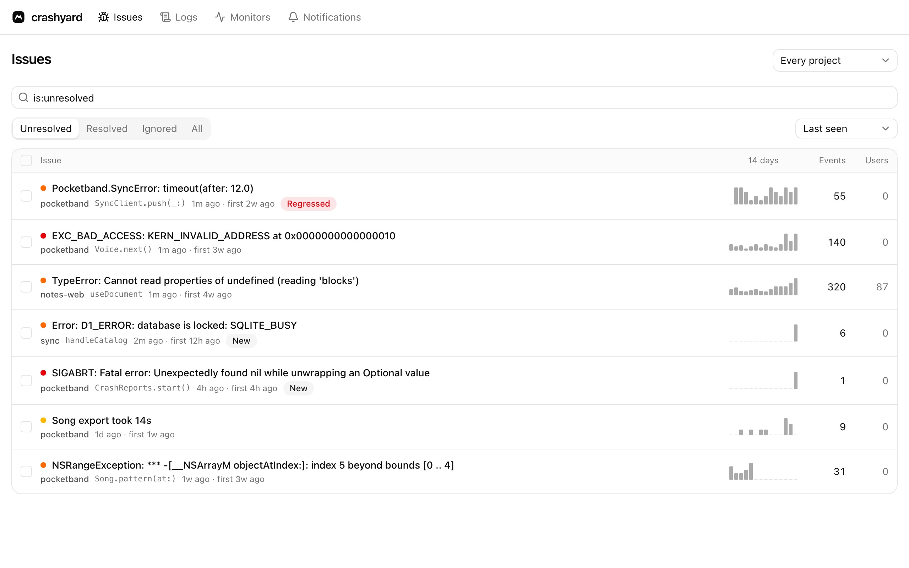

#  crashyard

[](https://scorecard.dev/viewer/?uri=github.com/marctorrelles/crashyard)

Crash reporting, error tracking and logs that run on your own Cloudflare account.

Your apps keep the official Sentry SDKs they already use. crashyard groups their crashes into issues, turns stack
traces back into readable code, and tells you when something new breaks. It is a single Cloudflare Worker with D1 and
R2, so most apps stay within Cloudflare's free plan.

Apps with native crashes or source maps need the Workers Paid plan. Turning their stack traces back into code takes
more processing time than the free plan's 10 ms a request. crashyard finds which plan your account is on by itself, and
warns on the pages that need Paid.

crashyard speaks Sentry's protocol. It isn't affiliated with Sentry.

<picture>
  <source media="(prefers-color-scheme: dark)" srcset="docs/images/issues-dark.jpg">
  
</picture>

## Get started

1. Deploy it to your Cloudflare account.

   [](https://deploy.workers.cloudflare.com/?url=https://github.com/marctorrelles/crashyard)

2. Open it, create your owner passkey with the setup code, and invite your team.
3. Create a project for each app and give its Sentry SDK the project's DSN.

[docs/deploying.md](docs/deploying.md) walks through every step, including deploying from a clone.

## What it does

- **Issues.** Crashes and errors are grouped the way Sentry groups them. Resolve them now or in the next release, ignore
  them for a while, merge duplicates, add notes, and search with Sentry's query syntax. A resolved issue that comes back
  is flagged as a regression.
- **Readable stack traces.** Upload dSYMs, ProGuard and R8 mappings, Android native libraries and source maps with
  `sentry-cli` or the Sentry build plugins. crashyard reads them with Sentry's own `symbolic` library, and crashes that
  arrived before their files are processed again automatically.
- **Links to your code.** Each stack frame opens its line on GitHub or GitLab, and each release lists the commits it
  shipped.
- **Releases.** See what is new, what regressed and what is gone in each release, with crash-free sessions. Crashes from
  App Review and TestFlight are called out.
- **Logs.** Search Sentry logs, follow them live, group them and jump to the issues in the same trace.
- **Dashboards.** Build charts, numbers and tables from issues, events and logs, or start from the Crashes template.
- **Monitors.** Cron monitors for scheduled jobs and uptime checks for URLs, with public status pages
  showing the checks you choose from any of your projects, and incidents, notices and planned maintenance you post with their updates, the services they affect, your
  own look and your own domain.
- **Cloudflare Workers.** Catch the runs that run out of CPU time or memory, which a Worker's SDK never gets to send.
- **Performance.** Transactions by p95, how each release changed them, and the slowest ones with their spans.
- **Notifications.** Alerts through Telegram, Slack, Discord, email or a JSON webhook, routed by alert type, project,
  level and environment, with quiet hours and a weekly summary. Resolve, ignore or assign an issue right from its
  alert: in the chat on Telegram, in one tap on crashyard from the others. Every alert sent in the last 30 days is
  listed, with where it went.
- **Moving from Sentry.** Bring a project's issues over with their latest event, counts, status and comments. Events
  from the SDK keep coming to the same issues. Until you switch, every event can go on to Sentry too.
- **MCP server.** Lets an AI agent read issues, events, logs, traces, releases, performance and monitors, triage issues
  and post to status pages. See
  [docs/mcp.md](docs/mcp.md).
- **People and sign-in.** Passkeys, invites and four roles, from owner to viewer, with recovery codes and an optional
  Sign in with GitHub.

## Supported SDKs

| SDK                               | Status           | Stack traces                             |
| --------------------------------- | ---------------- | ---------------------------------------- |
| Apple, sentry-cocoa               | Works            | Symbolicated from dSYMs                  |
| Android, sentry-android with NDK  | Expected to work | From the R8 mapping and native libraries |
| JavaScript in the browser         | Works            | From source maps                         |
| Node.js                           | Works            | As sent                                  |
| Python, Ruby, PHP, Go, Java, .NET | Works            | As sent                                  |
| Elixir, Rust, Dart                | Works            | As sent, or from debug files             |

To connect an app, see [docs/linking.md](docs/linking.md). For exactly which parts of Sentry's protocol and API work,
see [docs/sentry-compatibility.md](docs/sentry-compatibility.md).

## Privacy

crashyard sends no telemetry. The only request it makes on its own is a daily check with GitHub for a newer release, so
the overview can tell you about it. It stores no IP addresses, keeps a user only as a hash of the app's user ID, and
removes anything that looks like a password, token or email address from events and logs.

## Development

```sh
pnpm install
pnpm dev      # the dashboard at http://localhost:3000, with local D1 and R2
pnpm seed     # fills it with a month of sample crashes, logs and transactions
pnpm check    # lint, formatting, types, unused code, tests and the build, as CI runs them
```

- [How it fits together](docs/architecture.md)
- [Contributing](CONTRIBUTING.md)
- [Upgrading a deployment](docs/upgrading.md)

crashyard is released under the [MIT license](LICENSE).
