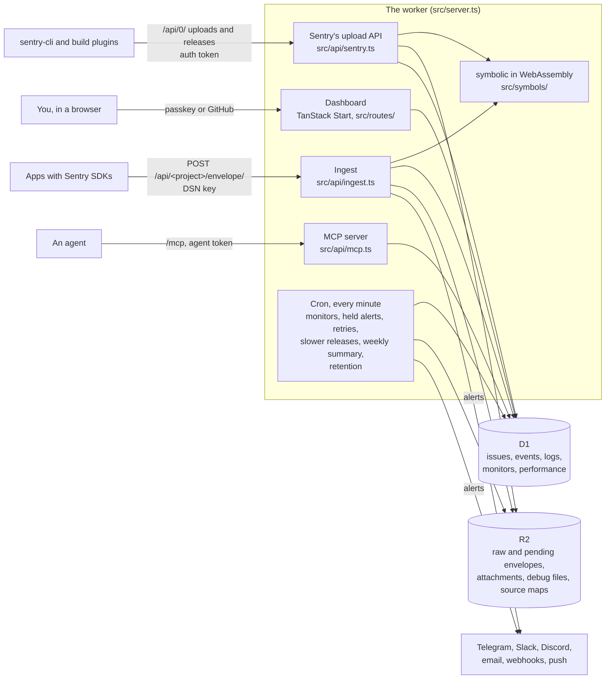

# How crashyard is built

A single Cloudflare Worker does everything. It receives what the Sentry SDKs and sentry-cli send, serves the
dashboard and runs a scheduled task every minute. D1, Cloudflare's SQLite database, holds everything that is searched or
listed. R2 holds files.

- **Ingest**, in `src/api/ingest.ts` and `src/ingest/`. Each envelope is checked against its project's key and daily
  limits, kept in R2 while it's processed, then each item in it is handled. An item that fails is tried again by the
  scheduled task. An event is scrubbed, symbolicated, fingerprinted and stored in its issue.
  Logs, check-ins, transactions and sessions go to their own tables. Anything worth an alert, such as a new issue, a
  regression or a threshold, becomes an alert that is sent after the response, through `ctx.waitUntil`.
- **Readable stack traces**, in `src/symbols/` and `symcache/`. Sentry's own `symbolic` library, written in Rust, is
  compiled to WebAssembly and runs in the worker. Uploads are turned into SymCaches and SourceMapCaches in R2, and each
  upload reprocesses the recent events that needed it.
- **The dashboard**, in `src/routes/`, `src/fns.ts` and `src/data/`. React is rendered on the server, with data from
  server functions that query D1. The worker checks who's signed in on every request, by their session, and each
  change by their role, in `src/auth/`. Signed out, only the sign-in pages open.
- **The scheduled task**, `scheduled` in `src/server.ts`. Every minute it runs uptime checks and looks for missed
  check-ins, in `src/monitors/`, sends alerts held through quiet hours, and tries again the envelopes that failed. Every 5 minutes it checks metric alerts, and every hour
  it looks for slower releases and deletes data past its retention. On Mondays at 07:00 UTC it sends the weekly
  summary, and each day at 03:40 UTC it installs a newer release, if an owner turned that on, from `src/update/`. Every run stops within 40 seconds, and envelopes to try again come last.
- **Search**, in `src/search/`. Sentry's query syntax is turned into parameterized SQL, with FTS5 for free text.

The reasons behind these choices are in [decisions/](decisions/).
