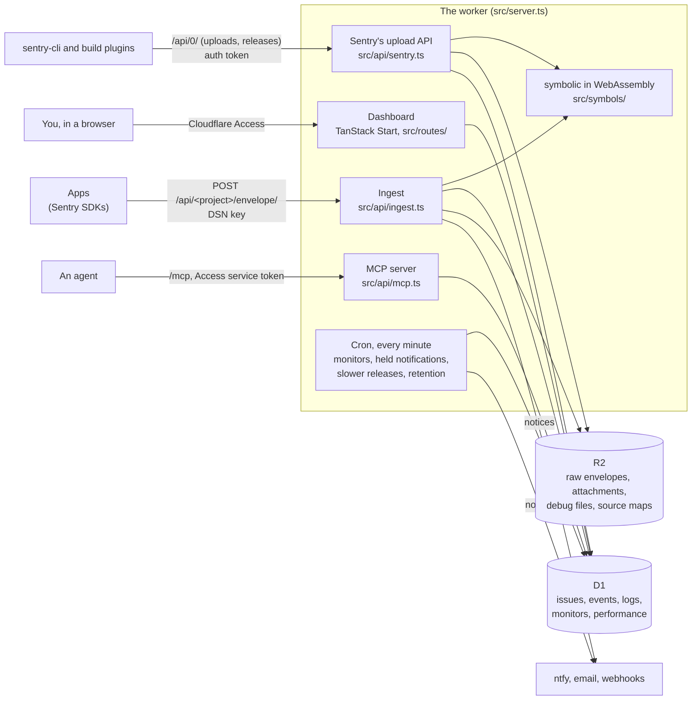

# How crashyard is built

One Cloudflare Worker does everything: it takes what the Sentry SDKs and sentry-cli send, serves the dashboard, and
runs a cron every minute. D1 (SQLite) holds everything that's searched or listed; R2 holds files.

- **Ingest** (`src/api/ingest.ts`, `src/ingest/`): an envelope is read, checked against its project's key and daily
  quotas, and each item handled: an event is scrubbed, symbolicated, fingerprinted and stored into its issue; logs,
  check-ins, transactions and sessions go to their own tables. What it causes (a new issue, a regression, a threshold)
  becomes notices, sent after the answer (`ctx.waitUntil`).
- **Readable stacks** (`src/symbols/`, `symcache/`): Sentry's own `symbolic`, in Rust, built to WebAssembly and run in
  the worker. Uploads become SymCaches and SourceMapCaches in R2; an upload re-reads the recent events that needed it.
- **The dashboard** (`src/routes/`, `src/fns.ts`, `src/data/`): React rendered on the server, its data from server
  functions over D1. The worker checks Access's token on every request itself, so a dashboard route that Access
  missed stays closed.
- **The cron** (`scheduled` in `src/server.ts`): uptime checks and missed check-ins (`src/monitors/`), notifications
  held through quiet hours, hourly the slower-release check, and at 03:00 UTC retention.
- **Search** (`src/search/`): Sentry's query syntax turned into SQL with parameters, FTS5 for free text.

Why these choices: [decisions/](decisions/).
